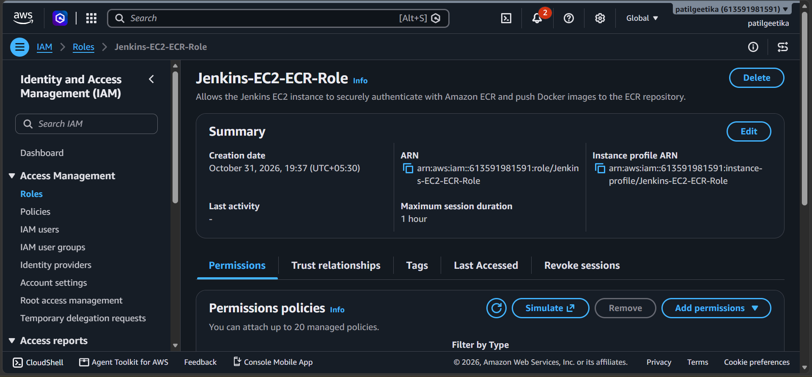
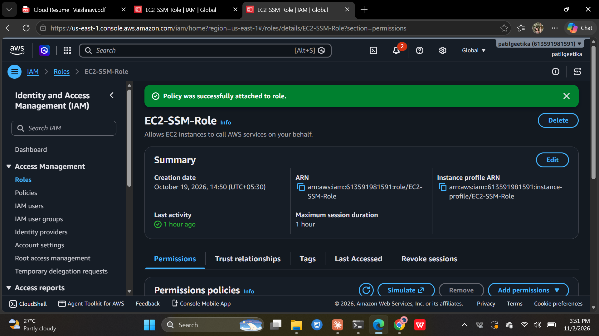
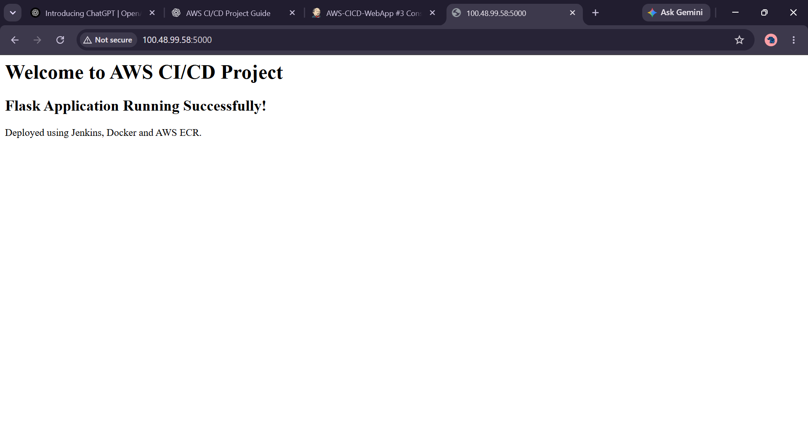

## 📸 Project Implementation Screenshots

### 01. Docker Installation

### 02. AWS IAM Role Creation

### 03. AWS IAM Role Verification

### 04. IAM Permissions for Amazon ECR

### 05. Amazon ECR Repository Creation

### 06. Jenkins Dashboard

### 07. Jenkins Plugin Installation

### 08. GitHub Jenkinsfile Integration

### 09. Jenkins Docker ECR Pipeline Configuration

### 10. Jenkins Pipeline Build Success

### 11. Docker Login to Amazon ECR

### 12. Docker Image Successfully Pushed to ECR

### 13. Local Application Testing

### 14. Application Deployment on AWS EC2

### 15. Project Resume Reference
